### Escuela Colombiana de Ingenieria
### Arquitecturas de Software - ARSW

# Laboratorio 10 - Escalabilidad Serverless con Azure Functions

**Integrantes:** 
Julio Mayorquin - Diego Patiño 
---

## Parte 0 - Entendiendo el escenario de calidad

La aplicacion entregada es una **Azure Function con trigger HTTP** escrita en Node.js que recibe en el cuerpo de la peticion un valor `nth` y responde con el enesimo numero de la secuencia de Fibonacci:

```http
POST /api/Fibonacci
Content-Type: application/json

{ "nth": 1000000 }
```

### Escenario de calidad (Escalabilidad)

| Elemento | Descripcion |
|---|---|
| **Fuente** | Un conjunto de usuarios concurrentes |
| **Estimulo** | Consultan, de forma concurrente, el enesimo numero de Fibonacci con `n > 1.000.000` |
| **Artefacto** | Function App que expone la funcion `Fibonacci` |
| **Ambiente** | Condiciones normales de operacion |
| **Respuesta** | El sistema atiende todas las peticiones |
| **Medida de la respuesta** | El 100 % de las peticiones se responde correctamente y el consumo de CPU no supera el 70 % |

### Por que este escenario es exigente?

La funcion calcula Fibonacci de forma **iterativa** con enteros de precision arbitraria (`big-integer`):

```js
for (var i = 0; i < nth - 1; i++) {
    answer = nth_2.add(nth_1)
    nth_2 = nth_1
    nth_1 = answer
}
```

- Hace `n - 1` sumas, pero cada suma opera sobre numeros cada vez mas grandes. `F(n)` tiene aproximadamente `n * log10(phi) ~ 0,209 * n` digitos, asi que **F(1.000.000) tiene 208.988 digitos** (~ 694.000 bits).
- Como el costo de cada suma es proporcional al tamano del numero, el costo total crece como **O(n^2)** en operaciones sobre bits. Ademas, convertir el resultado a texto (`answer.toString()`) tambien es costoso y genera una respuesta de ~209 KB.
- El trabajo es **100 % CPU** y **sincrono**: mientras el ciclo se ejecuta, el *event loop* de Node.js queda bloqueado. Si una misma instancia recibe varias peticiones grandes, estas compiten por la misma CPU y cada una tarda proporcionalmente mas (se comprueba en la Parte 5).

Por esto, escalar **verticalmente** (una maquina mas potente) ayuda poco: lo que se necesita es **escalar horizontalmente**, repartiendo las peticiones concurrentes entre varias instancias. Ese es justamente el modelo que ofrece *serverless*: la plataforma agrega o quita instancias segun la carga, sin que nosotros administremos servidores.

---

## Parte 1 - Creacion de la Function App

> **Nota sobre el plan de hospedaje:** el enunciado muestra el plan *Consumption (Serverless)* sobre Windows. Hoy Microsoft clasifica ese plan como *legacy* y recomienda **Flex Consumption** para toda nueva aplicacion serverless (ademas, el plan Consumption en Linux se retira el 30 de septiembre de 2028). Por eso se utilizo **Flex Consumption**, que conserva las caracteristicas que el laboratorio quiere evaluar: escala automatica segun la demanda, escala a cero cuando no hay trafico y pago por uso.

Se creo la Function App en el portal de Azure con la siguiente configuracion:

| Parametro | Valor | Justificacion |
|---|---|---|
| Plan de hospedaje | **Flex Consumption** | Plan serverless recomendado por Microsoft: escala automaticamente (incluso a cero instancias) y se paga solo por uso. |
| Sistema operativo | **Linux** | Flex Consumption solo esta disponible sobre Linux. |
| Grupo de recursos | `rg-arsw-lab10` | Agrupa todos los recursos del laboratorio para administrarlos (y eliminarlos) juntos. |
| Nombre | `fibonacci-arsw-jj` | Dominio asignado: `fibonacci-arsw-jj-dcd8dmb2hrbygue4.northcentralus-01.azurewebsites.net` |
| Region | **North Central US** | Region permitida por la suscripcion *Azure for Students*; es la misma del grupo de recursos. |
| Runtime stack | **Node.js** | El proyecto esta escrito en JavaScript. |
| Version | **Node.js 22 LTS** | La imagen del enunciado usa Node 12, que ya no esta soportado. Node 22 es una version LTS soportada por el runtime 4.x de Azure Functions (fin de soporte: 30/04/2027). |
| Tamano de instancia | **2048 MB** | Valor por defecto. En Flex Consumption la memoria de la instancia tambien determina su CPU y cuantas peticiones HTTP concurrentes acepta cada instancia (16 por defecto con 2048 MB). |
| Redundancia de zona | Deshabilitada | No es necesaria para el alcance del laboratorio y evita costos adicionales. |
| Storage account | `rgarswlab10856d` (nueva) | Azure Functions la requiere para operar (ver preguntas). |
| Application Insights | Habilitado | Permite ver invocaciones, tiempos de respuesta, logs y consumo de CPU durante las pruebas. |

**Configuracion basica (Basics):**

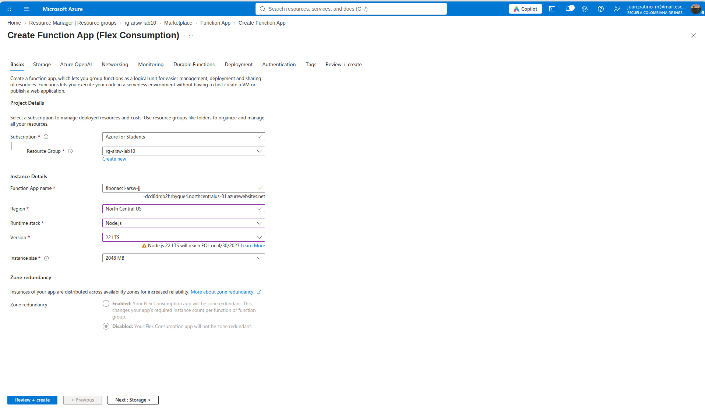

**Cuenta de almacenamiento (Storage):**

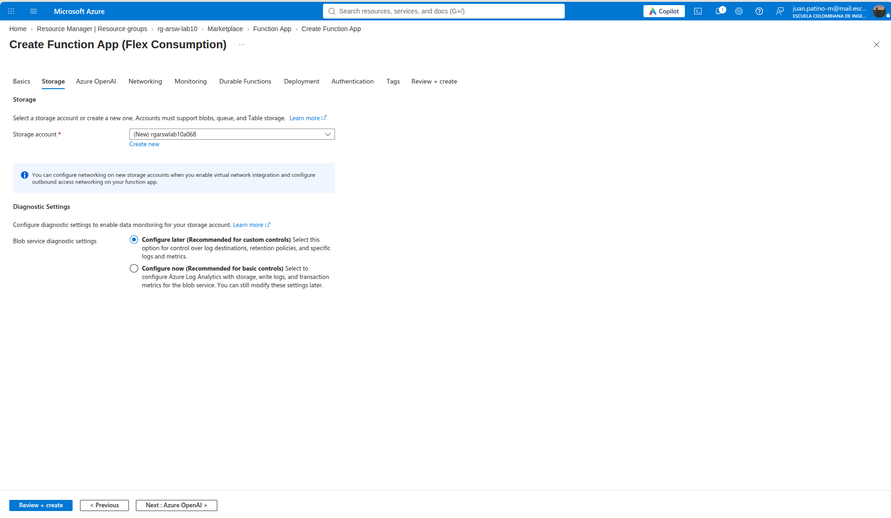

**Despliegue de los recursos:** al crear la Function App, Azure aprovisiona en el grupo de recursos el plan Flex Consumption (`ASP-rgarswlab10-96db`, tipo `Microsoft.Web/serverfarms`), la cuenta de almacenamiento y Application Insights:

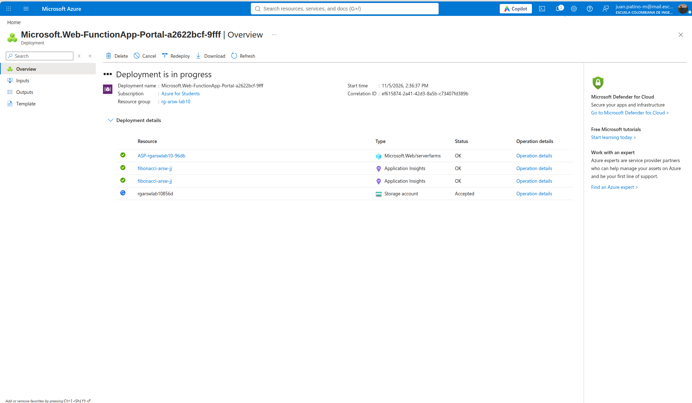

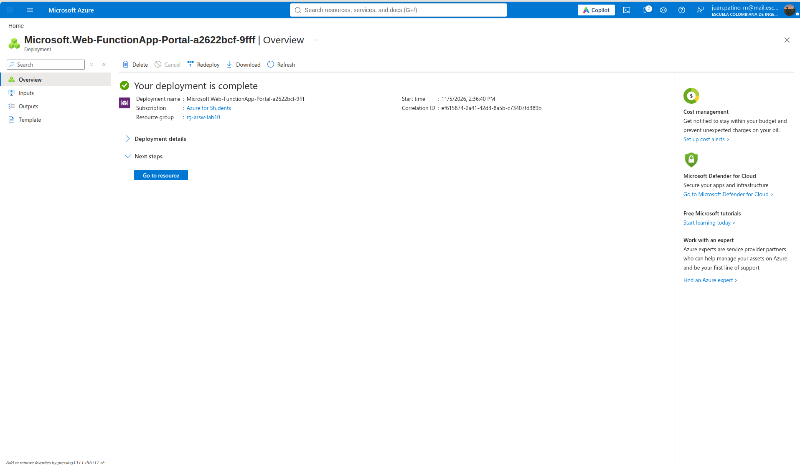

**Function App creada (Overview):**

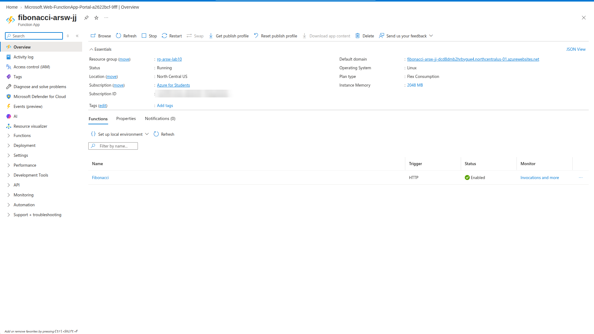

En el *Overview* se confirma la configuracion: estado **Running**, sistema operativo **Linux**, plan **Flex Consumption**, memoria de instancia **2048 MB** y region **North Central US**.

---

## Parte 2 - Extension de Azure Functions para Visual Studio Code

Se instalo la extension **Azure Functions** (`ms-azuretools.vscode-azurefunctions`, version 1.22.2) en Visual Studio Code. Esta extension permite crear, ejecutar localmente y desplegar funciones directamente desde el editor; al instalarla tambien se agrega la extension *Azure Resources*, desde la cual se inicia sesion con la suscripcion de Azure.

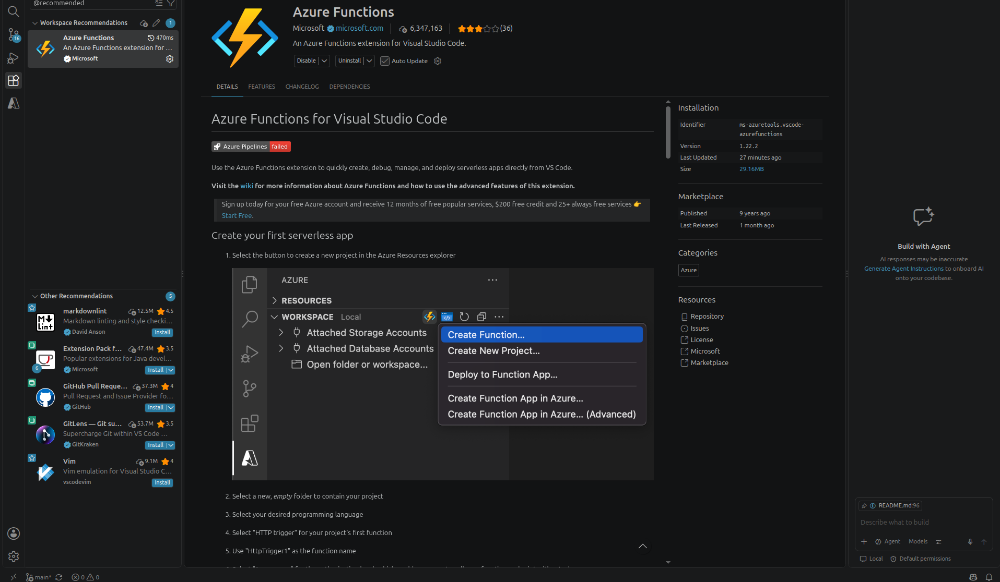

---

## Parte 3 - Despliegue de la funcion Fibonacci

### Ajustes al proyecto base

El proyecto entregado fue creado para el **runtime 2.x** de Azure Functions, que Microsoft ya retiro (hoy solo se soporta el runtime **4.x**). Para poder desplegarlo se hicieron los siguientes ajustes minimos, sin modificar la logica de la funcion:

| Archivo | Antes | Despues | Motivo |
|---|---|---|---|
| `FunctionProject/host.json` | `extensionBundle` `[1.*, 2.0.0)` | `[4.*, 5.0.0)` | El runtime 4.x requiere el *extension bundle* 4.x. |
| `.vscode/settings.json` | `projectRuntime: "~2"` | `projectRuntime: "~4"` | Version del runtime de destino. |
| `.vscode/settings.json` | `preDeployTask: npm prune` / `postDeployTask: npm install` | `preDeployTask: npm install (functions)` | Garantiza que `node_modules` (con `big-integer`) exista y se empaquete **antes** de desplegar. |
| `FunctionProject/Fibonacci/sample.dat` | `{"name": "Azure"}` | `{"nth": 10}` | El ejemplo no correspondia al parametro que lee la funcion (`req.body.nth`). |

Se mantuvo el **modelo de programacion v3 de Node.js** (un `function.json` por funcion), que sigue soportado en el runtime 4.x con Node.js 22.

### Despliegue desde Visual Studio Code

La funcion se desplego con la extension de Azure Functions (*Deploy to Function App...*) sobre la Function App `fibonacci-arsw-jj`:

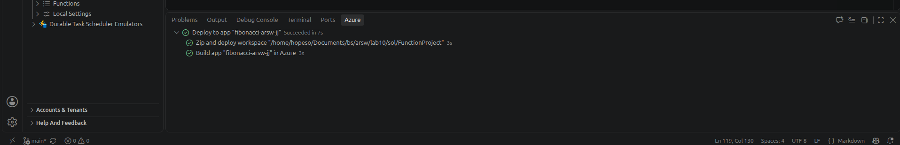

El despliegue se hizo con *zip deploy*: la extension empaqueta la carpeta `FunctionProject` (incluyendo `node_modules`), la sube a Azure y la plataforma completa el *build* de la aplicacion. Todo el proceso tomo unos 7 segundos.

En el portal, la funcion **Fibonacci** aparece registrada con trigger **HTTP** y estado **Enabled**:


---

## Parte 4 - Prueba de la funcion

La funcion expone el endpoint:

```
POST https://fibonacci-arsw-jj-dcd8dmb2hrbygue4.northcentralus-01.azurewebsites.net/api/Fibonacci
Content-Type: application/json

{ "nth": 10 }
```

### Prueba desde el portal de Azure

Se probo la funcion desde el portal (*Code + Test -> Test/Run*) enviando `{"nth": 10}`; la respuesta fue `55` con codigo HTTP 200:

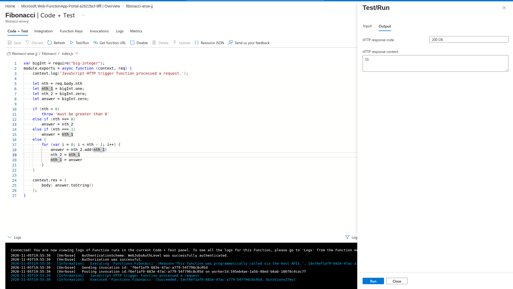

En los logs del panel se observa el ciclo de la invocacion: `Executing 'Functions.Fibonacci'` -> `JavaScript HTTP trigger function processed a request.` -> `Executed 'Functions.Fibonacci' (Succeeded, Duration=27ms)`.

### Prueba con distintos tamanos de entrada

Adicionalmente se invoco el endpoint con `curl` para distintos valores de `n` (una peticion a la vez):

| `nth` | Codigo HTTP | Tamano de la respuesta | Tiempo total |
|---:|:---:|---:|---:|
| 10 | 200 | `55` | 0,79 s (incluye *cold start*) |
| 100 | 200 | `354224848179261915075` | 0,34 s |
| 10.000 | 200 | 2.090 digitos | 0,34 s |
| 100.000 | 200 | 20.899 digitos | 0,46 s |
| **1.000.000** | **200** | **208.988 digitos** | **7,62 s** |

Los resultados confirman el analisis de la Parte 0: al multiplicar `n` por 10 (de 100.000 a 1.000.000) el tiempo pasa de ~0,5 s a ~7,6 s, un crecimiento claramente superlineal producido por el costo de sumar enteros cada vez mas grandes. Una sola peticion con `n = 1.000.000` ocupa la CPU de la instancia durante varios segundos.

---

## Parte 5 - Prueba de carga concurrente con Newman

### Coleccion y ejecucion concurrente

Newman ejecuta las peticiones de una coleccion **de forma secuencial**; aunque se usen varias iteraciones (`-n 10`), cada peticion espera a que termine la anterior. Para generar **10 peticiones verdaderamente concurrentes** se lanzan **10 procesos de Newman en paralelo**, cada uno con una peticion, y se espera a que todos terminen.

Archivos (carpeta [`postman/`](postman/)):

| Archivo | Descripcion |
|---|---|
| [`ARSW_LAB10_FIBONACCI.postman_collection.json`](postman/ARSW_LAB10_FIBONACCI.postman_collection.json) | Peticion `POST {{FUNCTION_URL}}/api/{{FUNCTION_NAME}}` con cuerpo `{"nth": {{nth}}}`. Incluye *tests* que validan el codigo **200** y que la respuesta sea un numero. |
| [`ARSW_LAB10.postman_environment.json`](postman/ARSW_LAB10.postman_environment.json) | Variables: URL de la Function App, nombre de la funcion y `nth = 1000000`. |
| [`run-concurrent.sh`](postman/run-concurrent.sh) | Lanza `N` procesos de Newman en paralelo (por defecto 10) y guarda el reporte de cada uno en `postman/results/`. |
| [`summarize.js`](postman/summarize.js) | Consolida los reportes JSON de Newman en una tabla: codigo HTTP, instante de inicio, tiempo de respuesta e instante de fin de cada peticion. |

Ejecucion: primero se instala Newman localmente (`npm install`) y luego se lanzan 10 peticiones concurrentes con `nth = 1.000.000`:

```bash
cd postman
npm install
./run-concurrent.sh 10 1000000
```

### Ejecucion 1 - Configuracion por defecto (concurrencia HTTP = 16 por instancia)

Antes de la prueba, una sola peticion con `nth = 1.000.000` sobre una instancia caliente tardaba **~7 s** (Parte 4). Se lanzaron 10 peticiones concurrentes:

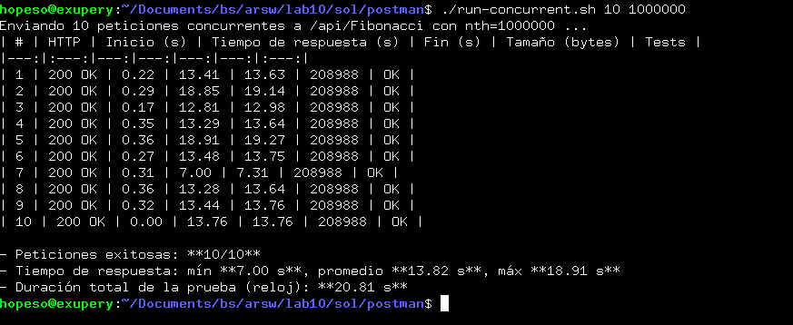

| # | HTTP | Inicio (s) | Tiempo de respuesta (s) | Fin (s) | Tamano (bytes) | Tests |
|---:|:---:|---:|---:|---:|---:|:---:|
| 1 | 200 OK | 0.22 | 13.41 | 13.63 | 208988 | OK |
| 2 | 200 OK | 0.29 | 18.85 | 19.14 | 208988 | OK |
| 3 | 200 OK | 0.17 | 12.81 | 12.98 | 208988 | OK |
| 4 | 200 OK | 0.35 | 13.29 | 13.64 | 208988 | OK |
| 5 | 200 OK | 0.36 | 18.91 | 19.27 | 208988 | OK |
| 6 | 200 OK | 0.27 | 13.48 | 13.75 | 208988 | OK |
| 7 | 200 OK | 0.31 | 7.00 | 7.31 | 208988 | OK |
| 8 | 200 OK | 0.36 | 13.28 | 13.64 | 208988 | OK |
| 9 | 200 OK | 0.32 | 13.44 | 13.76 | 208988 | OK |
| 10 | 200 OK | 0.00 | 13.76 | 13.76 | 208988 | OK |

- Peticiones exitosas: **10/10**
- Tiempo de respuesta: min **7.00 s**, promedio **13.82 s**, max **18.91 s**
- Duracion total de la prueba (reloj): **20.81 s**

Durante la prueba, *Live Metrics* de Application Insights mostro **10 servidores (instancias) en linea**:

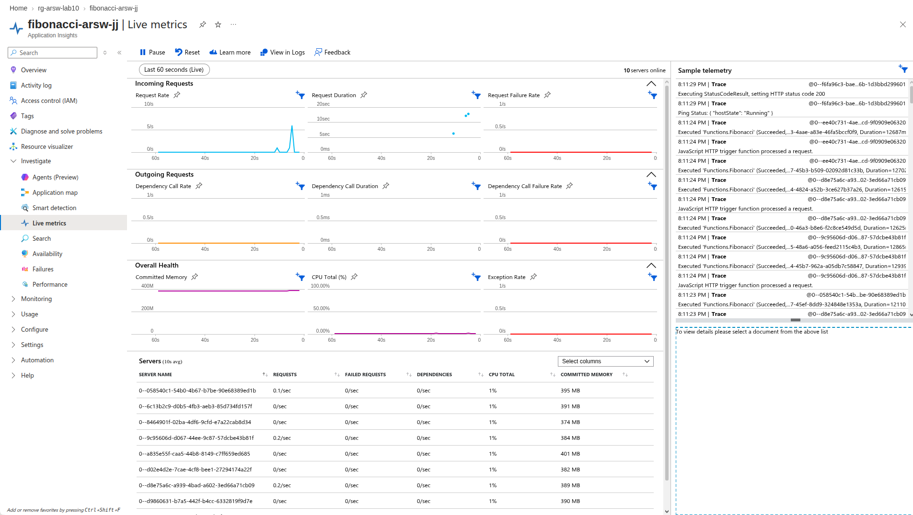

### Ejecucion 2 - Repeticion inmediata

La prueba se repitio un minuto despues, con instancias ya creadas por la ejecucion anterior. Resultados (`postman/results/20261105-151233-Fibonacci-nth1000000-c10/summary.md`):

| # | HTTP | Inicio (s) | Tiempo de respuesta (s) | Fin (s) | Tamano (bytes) | Tests |
|---:|:---:|---:|---:|---:|---:|:---:|
| 1 | 200 OK | 0.45 | 13.85 | 14.30 | 208988 | OK |
| 2 | 200 OK | 0.00 | 14.27 | 14.27 | 208988 | OK |
| 3 | 200 OK | 0.28 | 6.74 | 7.02 | 208988 | OK |
| 4 | 200 OK | 0.25 | 24.88 | 25.13 | 208988 | OK |
| 5 | 200 OK | 0.44 | 24.69 | 25.13 | 208988 | OK |
| 6 | 200 OK | 0.47 | 13.90 | 14.37 | 208988 | OK |
| 7 | 200 OK | 0.35 | 24.82 | 25.16 | 208988 | OK |
| 8 | 200 OK | 0.42 | 6.85 | 7.27 | 208988 | OK |
| 9 | 200 OK | 0.35 | 13.95 | 14.30 | 208988 | OK |
| 10 | 200 OK | 0.22 | 12.81 | 13.04 | 208988 | OK |

- Peticiones exitosas: **10/10**
- Tiempo de respuesta: min **6.74 s**, promedio **15.68 s**, max **24.88 s**
- Duracion total de la prueba (reloj): **26.63 s**

### Analisis de las ejecuciones 1 y 2

- **Disponibilidad:** en ambas ejecuciones se respondieron **10/10 peticiones** con HTTP 200 y el resultado completo (208.988 digitos). En ese aspecto se cumple el escenario de calidad: ninguna peticion se perdio.
- **La plataforma escalo horizontalmente:** sin ninguna configuracion adicional, Flex Consumption repartio la carga entre varias instancias (Live Metrics llego a mostrar *"10 servers online"*; parte de ellas venian de una prueba previa con `n` pequeno). Esto es el escalamiento *serverless*: no se aprovisiono ni administro ningun servidor. Sin embargo, como se verifica mas adelante con Application Insights, las 10 peticiones pesadas se atendieron en solo **5 instancias**.
- **Pero los tiempos de respuesta no son uniformes.** Las peticiones terminan en "escalones": unas a los **~7 s** (el tiempo de una peticion sola), otras a los **~13-14 s** y otras a los **~19-25 s**, es decir, aproximadamente **1x, 2x y 3x** el tiempo base.
- **Causa:** cada instancia acepta por defecto hasta **16 peticiones HTTP concurrentes** (instancias de 2048 MB). El balanceador puede asignar 2 o 3 peticiones a la misma instancia y, como el calculo es 100 % CPU, esas peticiones **compiten por la misma CPU**: cada una avanza a la mitad (o un tercio) de la velocidad. Los logs de Live Metrics lo confirman: el mismo servidor (`...ee40c731...`) registro dos ejecuciones simultaneas de `Functions.Fibonacci` con `Duration ~ 12.687 ms` y `~ 12.702 ms`, casi el doble de los ~7 s de una ejecucion aislada. La consulta de Application Insights de la ejecucion 3 confirma el patron: en las ejecuciones 1 y 2, **10 peticiones -> 5 instancias**, es decir, **2 peticiones por instancia**.
- **CPU:** el contador *CPU Total* de Live Metrics reporta ~1 % por servidor incluso mientras se calculaba Fibonacci, por lo que en Flex Consumption no es un indicador confiable del uso real de CPU. Lo que si es evidente es el efecto de la saturacion: cuando una instancia atiende mas de una peticion de este tipo, su CPU esta al 100 % y los tiempos se multiplican. Con la configuracion por defecto, el criterio de **CPU <= 70 %** no se puede garantizar.

Conclusion: el escalamiento automatico resuelve la **disponibilidad**, pero para cargas intensivas en CPU la concurrencia por instancia por defecto (pensada para cargas de E/S, donde una instancia si puede atender muchas peticiones a la vez) agrupa peticiones en la misma instancia y degrada el tiempo de respuesta. Para validarlo se ajusto la concurrencia por instancia a **1**.

### Ejecucion 3 - Concurrencia HTTP por instancia = 1

En *Settings -> Scale and concurrency* se cambio la concurrencia HTTP por instancia de *"Use a system-assigned number"* (16 para 2048 MB) a **asignacion manual = 1**. Asi, cada peticion concurrente obliga a la plataforma a usar una instancia distinta (el maximo de instancias bajo demanda es 100, suficiente para la prueba):

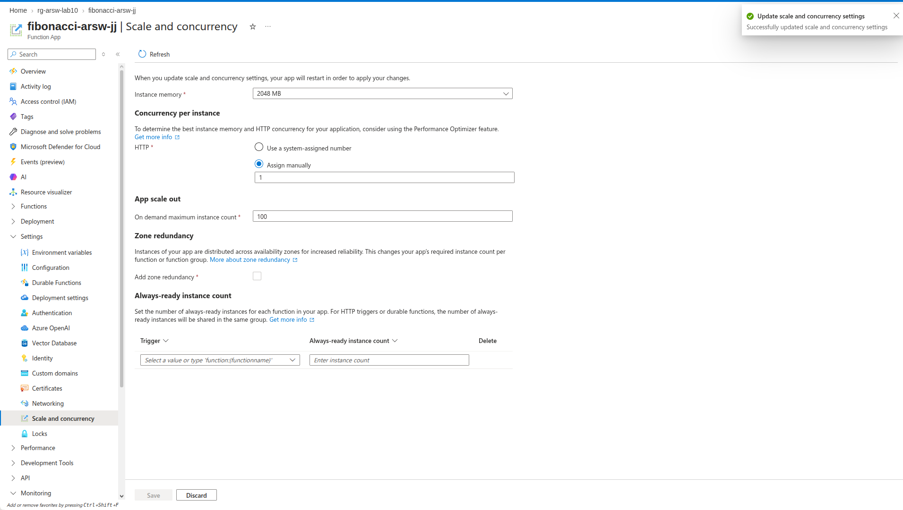

Resultados de las 10 peticiones concurrentes:

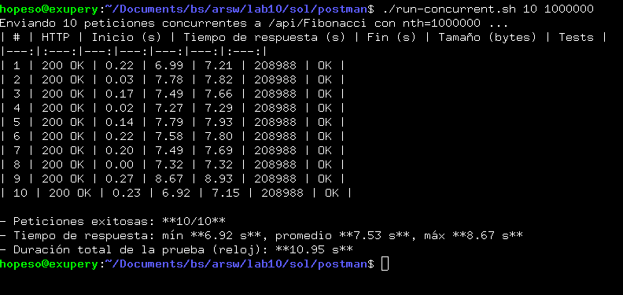

| # | HTTP | Inicio (s) | Tiempo de respuesta (s) | Fin (s) | Tamano (bytes) | Tests |
|---:|:---:|---:|---:|---:|---:|:---:|
| 1 | 200 OK | 0.22 | 6.99 | 7.21 | 208988 | OK |
| 2 | 200 OK | 0.03 | 7.78 | 7.82 | 208988 | OK |
| 3 | 200 OK | 0.17 | 7.49 | 7.66 | 208988 | OK |
| 4 | 200 OK | 0.02 | 7.27 | 7.29 | 208988 | OK |
| 5 | 200 OK | 0.14 | 7.79 | 7.93 | 208988 | OK |
| 6 | 200 OK | 0.22 | 7.58 | 7.80 | 208988 | OK |
| 7 | 200 OK | 0.20 | 7.49 | 7.69 | 208988 | OK |
| 8 | 200 OK | 0.00 | 7.32 | 7.32 | 208988 | OK |
| 9 | 200 OK | 0.27 | 8.67 | 8.93 | 208988 | OK |
| 10 | 200 OK | 0.23 | 6.92 | 7.15 | 208988 | OK |

- Peticiones exitosas: **10/10**
- Tiempo de respuesta: min **6.92 s**, promedio **7.53 s**, max **8.67 s**
- Duracion total de la prueba (reloj): **10.95 s**

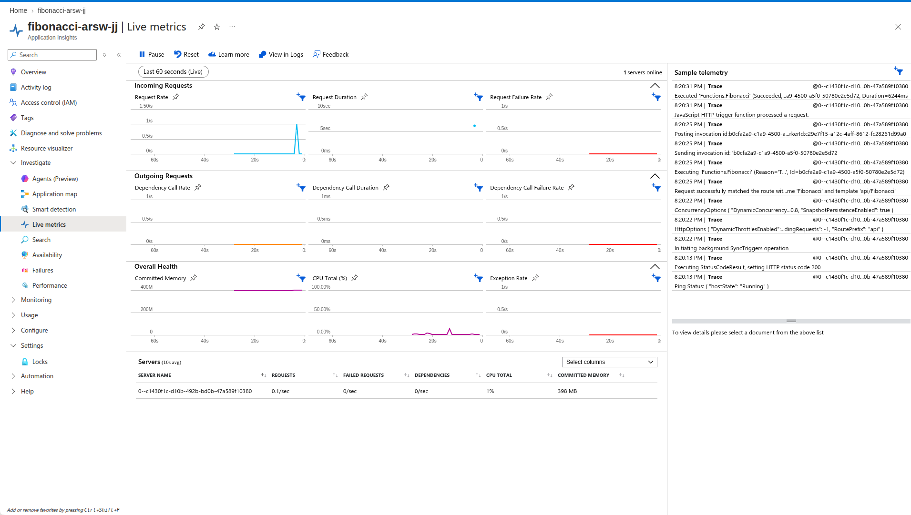

En *Live Metrics* se observa una ejecucion de `Functions.Fibonacci` con `Duration=6244ms`, el tiempo de computo de una peticion que tiene la CPU de la instancia para ella sola. Como toda la prueba duro ~11 s, las instancias nuevas terminaron su trabajo casi al mismo tiempo que se conectaban a Live Metrics, por eso el panel alcanza a mostrar un solo servidor. El numero real de instancias por prueba se verifico con una consulta a Application Insights:

```kusto
requests
| where timestamp > ago(2h) and name == "Fibonacci"
| summarize peticiones = count(),
            instancias = dcount(cloud_RoleInstance),
            duracion_promedio_s = round(avg(duration) / 1000, 2),
            duracion_maxima_s = round(max(duration) / 1000, 2)
          by minuto = bin(timestamp, 1m)
| order by minuto asc
```

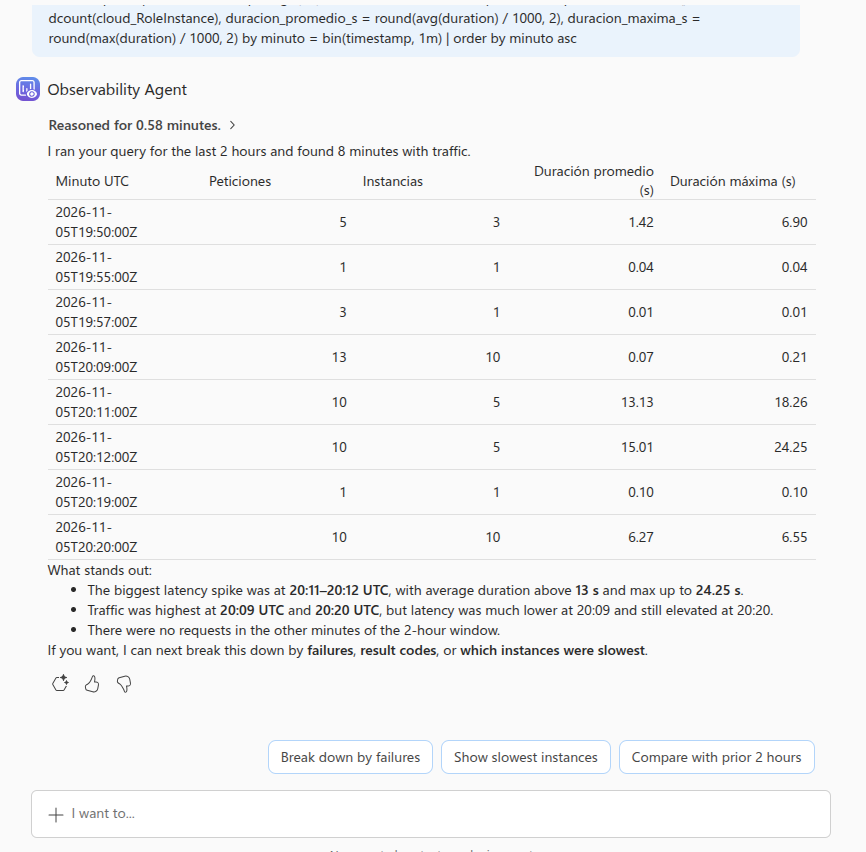

| Minuto (UTC) | Prueba | Peticiones | Instancias | Duracion promedio | Duracion maxima |
|---|---|---:|---:|---:|---:|
| 20:11 | Ejecucion 1 (concurrencia 16) | 10 | **5** | 13,13 s | 18,26 s |
| 20:12 | Ejecucion 2 (concurrencia 16) | 10 | **5** | 15,01 s | 24,25 s |
| 20:20 | Ejecucion 3 (concurrencia 1) | 10 | **10** | **6,27 s** | **6,55 s** |

*(Las filas restantes de la consulta corresponden a pruebas pequenas previas: la prueba en el portal y verificaciones del script con `n` pequeno.)*

Esta es la evidencia central del laboratorio: con la concurrencia por defecto, la plataforma ubico **2 peticiones por instancia** y la duracion de cada ejecucion se duplico (~13-15 s); con concurrencia 1 uso **una instancia por peticion** y cada ejecucion tomo ~6,3 s, el tiempo de un calculo con la CPU para el solo. La duracion que mide Azure (tiempo de ejecucion de la funcion) es ~1 s menor que el tiempo de respuesta medido por Newman, diferencia que corresponde a la red y a la transferencia de los ~209 KB de la respuesta.

### Comparacion y conclusiones

| Ejecucion | Concurrencia por instancia | Exitosas | Min | Promedio | Max | Duracion total |
|---|:---:|:---:|---:|---:|---:|---:|
| 1 | 16 (por defecto) | 10/10 | 7,00 s | 13,82 s | 18,91 s | 20,81 s |
| 2 | 16 (por defecto) | 10/10 | 6,74 s | 15,68 s | 24,88 s | 26,63 s |
| **3** | **1** | **10/10** | **6,92 s** | **7,53 s** | **8,67 s** | **10,95 s** |
| Referencia | - (1 sola peticion) | 1/1 | - | 7,62 s | - | - |

- Con concurrencia por instancia = 1, **las 10 peticiones concurrentes tardan practicamente lo mismo que una peticion aislada** (~7,5 s frente a 7,6 s). El tiempo promedio se redujo a **la mitad** y el peor caso a **un tercio** frente a la configuracion por defecto, y la prueba completa termino en la mitad del tiempo.
- La variabilidad desaparecio: todas las respuestas quedan entre 6,9 s y 8,7 s, en lugar de los escalones de 1x/2x/3x de las ejecuciones 1 y 2.
- **Respecto al escenario de calidad:** la parte de **disponibilidad** se cumple: todas las peticiones fueron respondidas en todas las ejecuciones. La parte de **CPU <= 70 %** no se pudo medir de forma confiable, porque el contador de Live Metrics reporta ~1 % en Flex Consumption. Si se puede razonar: Node.js ejecuta el calculo en un solo hilo, asi que una peticion mantiene ocupado un nucleo completo mientras dura. Con concurrencia 1 ninguna instancia acumula mas de un calculo (no hay contencion); con la configuracion por defecto, 2 o 3 calculos comparten la misma CPU y la saturan, como lo demuestran los tiempos 2x y 3x.
- **Costo:** el ajuste no encarece la solucion. En Flex Consumption se paga por tiempo de ejecucion x memoria, asi que 10 instancias trabajando ~7 s cada una consumen aproximadamente lo mismo que menos instancias trabajando el doble o el triple de tiempo.
- **Leccion:** el escalamiento serverless es automatico, pero **no es magico**. La configuracion por defecto asume cargas de E/S (esperar bases de datos o APIs), donde una instancia puede atender muchas peticiones a la vez. Para cargas **intensivas en CPU** como esta, hay que ajustar la concurrencia por instancia para que la plataforma escale horizontalmente en lugar de amontonar trabajo en la misma instancia.

> La configuracion de concurrencia = 1 se mantiene para el resto del laboratorio.

---

## Parte 6 - Fibonacci recursivo con memoization

### Implementacion

Se creo la funcion [`FibonacciMemo`](FunctionProject/FibonacciMemo/index.js) (trigger HTTP, mismo contrato `{"nth": n}`), que calcula Fibonacci de forma **recursiva** guardando cada resultado en una cache a nivel de modulo (el arreglo `memo`, que vive mientras viva el proceso de la instancia):

```js
const memo = [0n, 1n];

function fib(n) {
    if (memo[n] !== undefined) return memo[n];
    const value = fib(n - 1) + fib(n - 2);
    memo[n] = value;
    return value;
}
```

- Usa `BigInt` nativo de JavaScript (no requiere dependencias).
- Para hacer observable el comportamiento, la respuesta incluye, ademas del resultado, el estado de la cache (`cacheBefore`/`cacheAfter`, mayor `n` ya calculado), si fue un acierto de cache (`cacheHit`), el tiempo de computo, el identificador de la **instancia** que atendio la peticion y la hora en que esa instancia inicio.
- Si el calculo falla, responde HTTP 500 con el error en lugar de tumbar la ejecucion.

Para las pruebas se uso [`scripts/memo-test.js`](scripts/memo-test.js), que invoca la funcion secuencialmente con varios valores de `n` y tabula la respuesta.

### Despliegue

Se desplego nuevamente el proyecto desde VS Code; la Function App quedo con las dos funciones habilitadas:

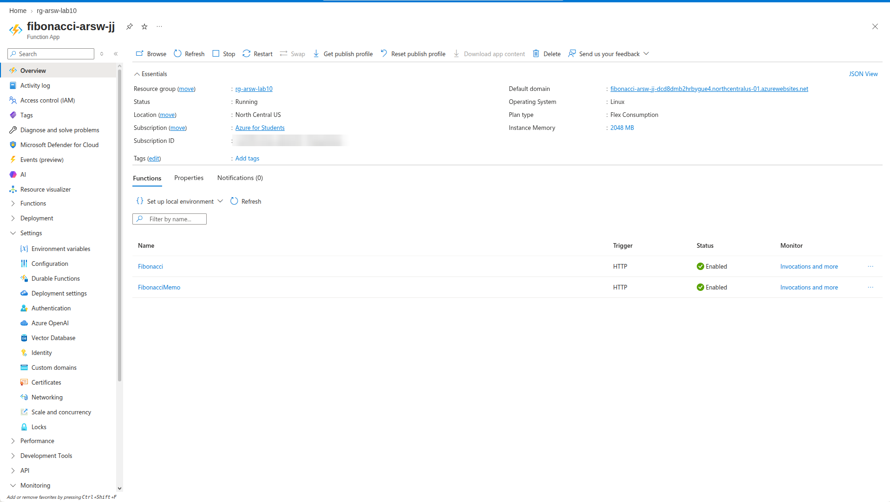

### Prueba 1 - Varias invocaciones seguidas (3:32:29 p. m.)

Secuencia `5000 -> 10000 -> 15000 -> 20000 -> 20000 -> 5000`, una peticion tras otra:

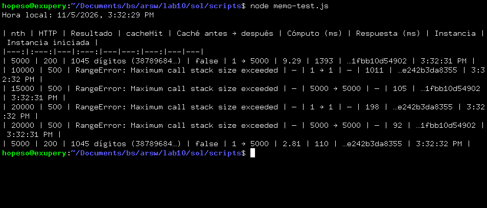

| nth | HTTP | Instancia | Cache antes | Que paso |
|---:|:---:|:---:|---:|---|
| 5000 | 200 | **A** (`...1fbb10d54902`) | 1 (vacia) | Calcula con 5.000 niveles de recursion; la cache de A queda hasta 5.000. |
| 10000 | **500** | **B** (`...e242b3da8355`) | 1 (vacia) | B no tiene la cache de A: necesita 10.000 niveles -> `RangeError: Maximum call stack size exceeded`. |
| 15000 | **500** | A | 5000 | Faltan 10.000 niveles (de 5.001 a 15.000) -> desbordamiento de pila. |
| 20000 | **500** | B | 1 | 20.000 niveles -> desbordamiento de pila. |
| 20000 | **500** | A | 5000 | 15.000 niveles -> desbordamiento de pila. |
| 5000 | 200 | B | 1 (vacia) | `cacheHit = false`: B **recalcula** un valor que A ya tenia en cache. |

### Prueba 2 - Repeticion 30 segundos despues (3:32:58 p. m.)

Secuencia `20000 -> 15000 -> 10000 -> 5000`:

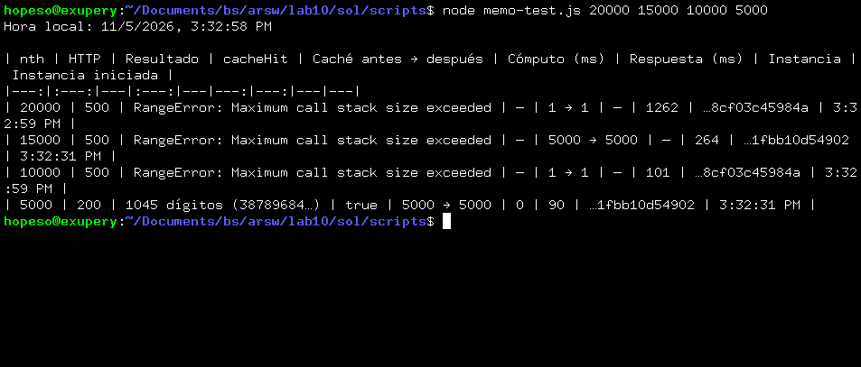

- Aparecio una **tercera instancia C** (`...8cf03c45984a`, iniciada a las 3:32:59), con la cache vacia: `20000` y `10000` fallan en ella.
- `15000` llega a A (cache hasta 5.000) y falla otra vez.
- `5000` llega a A y es un **acierto de cache** (`cacheHit = true`, 0 ms de computo): la memoization funciona **solo si la peticion cae en la misma instancia que ya calculo el valor**.

### Prueba 3 - Despues de 10+ minutos sin actividad

Tras mas de 12 minutos sin invocar la Function App (ultima peticion a las 3:32:58 p. m.), se ejecuto a las 3:45:08 p. m. la secuencia `5000 -> 5000 -> 5000 -> 5000`:

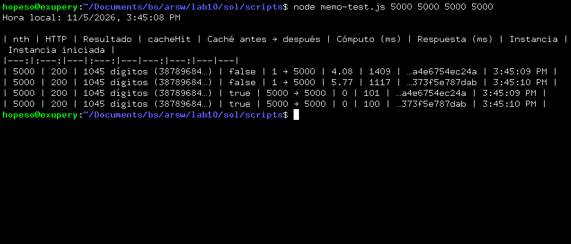

| # | Instancia | Instancia iniciada | Cache antes | `cacheHit` | Tiempo de respuesta |
|---:|:---:|:---:|---:|:---:|---:|
| 1 | **D** (`...a4e6754ec24a`) | 3:45:09 p. m. | 1 (vacia) | false | 1.409 ms |
| 2 | **E** (`...373f5e787dab`) | 3:45:10 p. m. | 1 (vacia) | false | 1.117 ms |
| 3 | D | 3:45:09 p. m. | 5000 | **true** | 101 ms |
| 4 | E | 3:45:10 p. m. | 5000 | **true** | 100 ms |

**Comportamiento observado:**

- **Las instancias anteriores (A, B y C) ya no existen.** Las peticiones las atendieron dos instancias **nuevas** (D y E), creadas en el momento de la peticion (iniciadas a las 3:45:09 y 3:45:10). Durante la inactividad, Flex Consumption **escalo a cero** y destruyo las instancias, y con ellas su memoria.
- **La cache se perdio.** Antes de la inactividad, `5000` era un acierto de cache en la instancia A (Prueba 2). Ahora las dos primeras peticiones tuvieron que **recalcularlo desde cero** (`cacheHit = false`, cache `1 -> 5000`).
- **Cold start:** las dos primeras respuestas tardaron **1,1-1,4 s**, frente a ~100 ms cuando la instancia ya estaba caliente. La diferencia es el tiempo de crear la instancia y cargar el runtime; el calculo en si tomo solo 4-6 ms.
- **La cache vuelve a ser util solo dentro de cada instancia:** las peticiones 3 y 4 fueron aciertos (0 ms de computo) porque cayeron en D y E respectivamente, que ya habian calculado el valor. Aun asi, el valor quedo **calculado dos veces**, una por instancia.

---

## Preguntas

### Que es un Azure Function?

Es el servicio de **computo serverless** (*Function as a Service*, FaaS) de Azure. Permite ejecutar fragmentos de codigo (funciones) en respuesta a **eventos**, sin administrar servidores:

- Cada funcion tiene exactamente un **trigger** que la dispara: una peticion HTTP (como `Fibonacci`), un temporizador, un mensaje en una cola, un archivo nuevo en un blob, un evento de Event Hubs o un cambio en Cosmos DB, entre otros.
- Los **bindings** de entrada y salida conectan la funcion con otros servicios de forma declarativa (en este laboratorio, `function.json` declara el binding `httpTrigger` de entrada y el binding `http` de salida).
- Las funciones se agrupan en una **Function App**, que es la unidad de despliegue, configuracion, escalamiento y facturacion. En este laboratorio, `fibonacci-arsw-jj` contiene `Fibonacci` y `FibonacciMemo`.
- La plataforma se encarga de aprovisionar la infraestructura, escalar segun la demanda, aplicar parches y mantener la disponibilidad.

### Que es serverless?

Es un modelo de ejecucion en la nube en el que **el proveedor administra completamente los servidores** y el desarrollador solo entrega codigo. "Serverless" no significa que no haya servidores, sino que no son responsabilidad del desarrollador. Sus caracteristicas principales:

- **Sin administracion de infraestructura:** no se crean ni se mantienen maquinas virtuales, sistemas operativos ni balanceadores.
- **Escalamiento automatico:** la plataforma agrega instancias cuando crece la carga y las retira cuando baja, **incluso hasta cero** (como se vio en la Parte 5, donde la plataforma paso a 5 y luego a 10 instancias sin intervencion).
- **Pago por uso:** se paga por ejecuciones y tiempo de computo, no por servidores encendidos. Si no hay trafico, no hay costo de computo.
- **Orientado a eventos y sin estado:** las instancias son efimeras, por lo que el estado debe guardarse en servicios externos (bases de datos, caches distribuidas, storage).

Sus desventajas son el **cold start** (latencia adicional cuando hay que crear una instancia), los limites de recursos por instancia y la imposibilidad de confiar en el estado en memoria, como se demuestra en la Parte 6.

### Que es el runtime y que implica seleccionarlo al momento de crear el Function App?

El **runtime de Azure Functions** es el *host* que ejecuta las funciones: carga la configuracion (`host.json`), gestiona los triggers y bindings, escala, registra logs y se comunica con el **language worker** del lenguaje elegido (aqui, el worker de Node.js). Al crear la Function App se selecciona el **runtime stack** (lenguaje) y su **version** (Node.js 22 LTS en este caso), sobre la version **4.x** del host, que es la unica soportada hoy.

Esta eleccion implica:

- **Lenguaje unico por Function App:** todas las funciones de la app deben estar en el mismo lenguaje.
- **Compatibilidad del codigo y de los bindings:** la version del host determina que *extension bundles* y modelos de programacion se pueden usar. Por eso el proyecto entregado (creado para el runtime 2.x, `extensionBundle [1.*, 2.0.0)`) tuvo que actualizarse a `[4.*, 5.0.0)` para poder desplegarse (Parte 3).
- **Sistema operativo y plan disponibles:** algunos stacks y planes solo existen en Linux o en Windows (Flex Consumption solo existe en Linux).
- **Ciclo de soporte:** cada version tiene fecha de fin de soporte. La imagen del enunciado usaba Node.js 12, que ya no se puede seleccionar; Node.js 22 tiene soporte hasta el 30/04/2027 (el portal lo advierte al crear la app). Despues habra que migrar de version.

### Por que es necesario crear un Storage Account de la mano de un Function App?

Porque el runtime de Azure Functions depende de una cuenta de almacenamiento (configurada en `AzureWebJobsStorage`) para operar. La cuenta debe soportar **Blob, Queue y Table**, y se usa para:

- **Claves de las funciones:** las *function keys* y *host keys* se guardan como blobs.
- **Coordinacion entre instancias:** el host usa *leases* (bloqueos) sobre blobs para que, cuando hay varias instancias, ciertas tareas se ejecuten en una sola (por ejemplo, que un timer trigger no se dispare una vez por instancia).
- **Estado de los triggers:** puntos de control (*checkpoints*) de Event Hubs, recibos de blobs ya procesados, colas internas.
- **Durable Functions:** el estado de las orquestaciones se guarda en tablas y colas.
- **El codigo de la aplicacion:** en Flex Consumption, el paquete desplegado se guarda en un contenedor blob de la cuenta (*deployment storage*), desde donde lo descargan las instancias al iniciar. En el plan Consumption clasico, el contenido de la app vive en un *file share* de la misma cuenta.

Sin la cuenta de almacenamiento las instancias no tendrian de donde obtener el codigo ni como coordinarse, por lo que la Function App no puede funcionar.

### Cuales son los tipos de planes para un Function App? En que se diferencian? Ventajas y desventajas

| Plan | Como funciona | Ventajas | Desventajas |
|---|---|---|---|
| **Flex Consumption** (usado en este laboratorio) | Serverless sobre Linux. Escala por funcion, desde cero hasta cientos de instancias. Se elige la memoria de la instancia (512, 2048 o 4096 MB) y la concurrencia por instancia. Opcionalmente, instancias *always ready*. | Escala a cero y se paga por uso. Escalamiento rapido. Concurrencia configurable (clave en la Parte 5). Integracion con redes virtuales. Es el plan serverless recomendado por Microsoft. | Solo Linux. *Cold start* si no se configuran instancias *always ready*. No admite contenedores personalizados. |
| **Consumption** (*legacy*) | Serverless clasico. Instancias de hasta 1,5 GB que se agregan y retiran automaticamente. | Escala a cero. Pago por uso con una cuota gratuita mensual generosa. Disponible en Windows. | *Cold start*. Tiempo maximo de ejecucion de 10 min. Sin integracion con redes virtuales. En Linux se retira en septiembre de 2028 y Microsoft lo considera *legacy*. |
| **Premium (Elastic Premium)** | Instancias **pre-calentadas** que siempre estan listas, y escalamiento elastico por encima de ellas. | Sin *cold start*. Instancias mas potentes (EP1-EP3). Ejecuciones largas sin limite estricto. Redes virtuales. | Hay que pagar al menos una instancia encendida todo el tiempo: costo fijo aunque no haya trafico. |
| **Dedicated (App Service Plan)** | Las funciones corren en las VM de un App Service Plan, igual que una aplicacion web. | Costo predecible. Aprovecha un plan que ya se este pagando. Ejecuciones largas. Sin *cold start* (*Always On*). | No es serverless: no escala a cero y el escalamiento es manual o por reglas de autoescalado. Se paga aunque no haya ejecuciones. |
| **Container Apps** | Funciones empaquetadas en contenedores que corren sobre Azure Container Apps, con escalamiento basado en eventos (KEDA). | Contenedores personalizados (dependencias del sistema, imagenes propias). Escala a cero. Convive con otros microservicios. | Mayor complejidad operativa (imagenes, registros de contenedores). Algunas caracteristicas de Functions tienen soporte limitado. |

En resumen: los planes **serverless** (Flex Consumption y Consumption) optimizan el costo para cargas variables a cambio de *cold starts*; **Premium** elimina los *cold starts* con un costo base; **Dedicated** y **Container Apps** dan mas control a cambio de perder parte de la experiencia serverless.

### Por que la memoization falla o no funciona de forma correcta?

Porque la memoization guarda los resultados **en la memoria del proceso**, y en serverless esa memoria es **local a cada instancia y efimera**. Las pruebas de la Parte 6 muestran cuatro razones concretas:

1. **La cache no se comparte entre instancias.** La plataforma reparte las peticiones entre varias instancias, incluso si llegan una tras otra. En la Prueba 1, `5000` se calculo en A y luego **se recalculo en B**, que no podia ver la cache de A. Cada instancia empieza con su propia cache vacia, asi que el beneficio de memorizar se divide entre todas.
2. **Las instancias son efimeras.** Tras unos minutos sin trafico, la plataforma escala a cero y destruye las instancias. Lo mismo ocurre al reiniciar o redesplegar la app, o cuando la plataforma recicla una instancia. En la Prueba 3, todas las instancias eran nuevas y los valores que antes eran aciertos se tuvieron que recalcular, ademas de pagar el *cold start*.
3. **La recursion desborda la pila.** Cada llamada recursiva ocupa un marco en la pila de Node.js (~1 MB por defecto), que admite en la practica unos 9.000 niveles para esta funcion. Con la cache vacia, calcular `F(n)` requiere `n` niveles de recursion, asi que valores como 10.000, 15.000 o 20.000 producen `RangeError: Maximum call stack size exceeded`. Que una peticion funcione o falle **depende de en que instancia caiga y de que tenga en su cache**: el mismo `15000` puede funcionar en una instancia "caliente" y fallar en una nueva. Para el `n = 1.000.000` del escenario de calidad, la version recursiva es **inviable**.
4. **La cache completa no cabe en memoria.** Memorizar todos los valores `F(0)...F(n)` exige guardar numeros de hasta 0,694*n bits cada uno: en total ~ 0,347*n^2 bits. Para `n = 1.000.000` eso es ~ **43 GB**, muy por encima de los 2 GB de la instancia.

En conclusion, la memoization en memoria choca con dos principios del modelo serverless: **las funciones deben ser sin estado** y **las instancias pueden aparecer y desaparecer en cualquier momento**. Si se quisiera reutilizar resultados, el estado tendria que guardarse **fuera de la instancia**, en una cache distribuida compartida (por ejemplo **Azure Cache for Redis**), en almacenamiento o con *Durable Entities*, y el calculo deberia ser **iterativo** (o usar el metodo de *fast doubling*, con O(log n) multiplicaciones) para no depender de la profundidad de la pila.

### Como funciona el sistema de facturacion de las Function App?

Depende del plan:

- **Flex Consumption (bajo demanda):** se cobra el **tiempo de ejecucion x la memoria de la instancia** (en GB-segundo) mientras la instancia esta ejecutando funciones, mas el **numero de ejecuciones**. Cada suscripcion tiene una cuota gratuita mensual de **100.000 GB-s y 250.000 ejecuciones**. Si se configuran instancias *always ready*, se cobra ademas una tarifa base, menor, por mantenerlas encendidas.
- **Consumption:** mismo principio (GB-s x ejecuciones), con un minimo facturable por ejecucion y una cuota gratuita mensual de **400.000 GB-s y 1.000.000 de ejecuciones**.
- **Premium:** se paga por los **nucleos (vCPU) y la memoria** de las instancias asignadas por segundo, incluidas las pre-calentadas, haya o no ejecuciones.
- **Dedicated:** se paga el **App Service Plan** (precio fijo por VM), independientemente de las ejecuciones.
- **Container Apps:** se paga el consumo de vCPU y memoria de los contenedores de Azure Container Apps.

Ademas, se pagan aparte los servicios asociados: la **cuenta de almacenamiento** (transacciones y capacidad) y **Application Insights** (volumen de telemetria ingerida).

**Estimacion para este laboratorio (Flex Consumption, 2048 MB = 2 GB):** la ejecucion 3 de la Parte 5 uso 10 instancias x ~6,3 s x 2 GB ~ **126 GB-s**. Las ejecuciones 1 y 2 usaron unas 5 instancias x ~13-15 s cada una, tambien del orden de 130-150 GB-s por prueba. Sumando todas las pruebas, el consumo total es de unos pocos cientos de GB-s y menos de 200 ejecuciones, muy por debajo de la cuota gratuita, asi que **el costo de computo del laboratorio es practicamente $0**. Esto tambien confirma lo dicho en la Parte 5: con concurrencia 1 se usaron mas instancias, pero durante menos tiempo, y el total de GB-s no aumenta.

---

## Informe

### Resumen

Se desplego en **Azure Functions (plan Flex Consumption, Linux, Node.js 22, runtime 4.x)** una funcion HTTP que calcula el enesimo numero de Fibonacci, y se evaluo su escalabilidad frente al escenario de calidad: *10 usuarios concurrentes consultan `F(n)` con `n = 1.000.000`*.

### Resultados principales

| Prueba | Resultado |
|---|---|
| Una peticion, `n = 1.000.000` | 200 OK en **7,6 s**, 208.988 digitos. |
| 10 concurrentes, concurrencia por instancia por defecto (16) | **10/10 respondidas**; la plataforma uso **5 instancias** (2 peticiones por instancia), con un promedio de **13,8-15,7 s** y un maximo de **24,9 s**. |
| 10 concurrentes, concurrencia por instancia = 1 | **10/10 respondidas**; **10 instancias** (una por peticion), con un promedio de **7,5 s** y un maximo de **8,7 s**. |
| Fibonacci recursivo con memoization | Funciona solo para `n` pequenos y solo dentro de la misma instancia. Desborda la pila a partir de ~9.000 niveles y pierde la cache cuando la plataforma reparte la carga o escala a cero. |

### Conclusiones

1. **El escalamiento serverless funciona sin administrar servidores.** Ante 10 peticiones concurrentes intensivas, Flex Consumption creo instancias automaticamente en segundos y **todas las peticiones fueron respondidas**, en todas las pruebas. Al terminar la carga, escalo a cero, asi que no hubo costo por capacidad ociosa.
2. **La configuracion por defecto no es adecuada para cargas intensivas en CPU.** La concurrencia por instancia por defecto (16) esta pensada para cargas de E/S. Con un calculo 100 % CPU, la plataforma ubico 2 peticiones por instancia y los tiempos de respuesta se **duplicaron y triplicaron**, porque las peticiones compartian la CPU.
3. **Ajustar la concurrencia por instancia a 1 resolvio el problema.** Cada peticion obtuvo una instancia propia y las 10 peticiones concurrentes tardaron practicamente **lo mismo que una sola peticion** (7,5 s frente a 7,6 s), sin aumentar el costo, que depende de GB-s consumidos y no del numero de instancias.
4. **El criterio de CPU <= 70 %** no se pudo medir directamente, porque Live Metrics no reporta un valor confiable de CPU en Flex Consumption. Arquitectonicamente, garantizarlo exige lo mismo que se hizo en el punto 3: que ninguna instancia acumule varios calculos simultaneos. Ademas, para el tiempo de respuesta conviene un algoritmo mas eficiente que O(n^2): por ejemplo, *fast doubling* con `BigInt` nativo.
5. **Las funciones deben ser sin estado.** La memoization en memoria fallo por diseno: cada instancia tiene su propia cache, las instancias se crean y destruyen segun la carga, y la recursion profunda desborda la pila. El estado compartido debe vivir en servicios externos (Redis, storage).
6. **Hay que tener en cuenta el *cold start*.** Tras la inactividad, la primera peticion tardo ~1,1-1,4 s mas. Si la latencia fuera critica, se pueden configurar **instancias *always ready*** en Flex Consumption (o usar el plan Premium), a cambio de un costo base.

### Estructura de la entrega

| Ruta (dentro de `sol/`) | Contenido |
|---|---|
| `README.md` | Este informe |
| `FunctionProject/` | Proyecto de Azure Functions (runtime 4.x, Node.js 22): `host.json`, `package.json` |
| `FunctionProject/Fibonacci/` | Funcion original (iterativa) |
| `FunctionProject/FibonacciMemo/` | Nueva funcion recursiva con memoization |
| `postman/ARSW_LAB10_FIBONACCI.postman_collection.json` | Coleccion de Postman |
| `postman/ARSW_LAB10.postman_environment.json` | Ambiente de Postman |
| `postman/run-concurrent.sh` | Lanza 10 procesos de Newman en paralelo |
| `postman/summarize.js` | Genera la tabla de resultados |
| `postman/results/` | Resumenes y logs de cada ejecucion |
| `scripts/memo-test.js` | Pruebas secuenciales de FibonacciMemo |
| `images/` | Evidencias |
| `.vscode/` | Configuracion de despliegue (runtime ~4) |

